# HOME・FAQ・ペット・自治体ページの確定修正（2026-11-25）

基点main：`150097f24ef471489002542d06a849d8e9515f99`（PR #172反映済み）。公開記事25件。未マージPR #134・#140・#144・#149はそれぞれ原稿下書き・計測準備・画像監査・SEO監査であり、今回の変更を取り込まず維持した。

## 変更前後

| 場所 | 変更前 | 変更後 |
| --- | --- | --- |
| ペットH1 | 大切な家族が、いつでもつながる安心を。 | 大切な家族の迷子に、声でつながる備えを。 |
| FAQ・電話番号の質問 | お互いの電話番号は相手に知られませんか？ | お互いの電話番号は相手に表示されますか？ |
| 同回答 | はい。「つながるQR」ではプライバシー電話番号を使用するため、お互いの本来の電話番号を相手に表示せずに通話できます。 | いいえ。つながるQRではプライバシー電話番号を使用するため、お互いの本来の電話番号を相手に表示せずに通話できます。 |
| FAQ・氏名住所の回答（質問は維持） | いいえ。QRコードをスキャンしても、登録者の氏名や住所が相手に知られることはありません。 | いいえ。QRコードをスキャンしても、登録者の氏名や住所は画面に表示されません。 |
| HOME PRICE末尾 | ペット向け商品について、皆さまのご意見を募集しています。／ペット向けアンケートに回答する | この案内・リンクのみ削除。ペット活用ページのアンケートは維持 |
| スマートフォンHERO | 写真とキャッチコピー（用途説明なし） | 写真直下に「高齢者・ペット・落とし物に。」を追加。767px以下のみ表示 |
| PRICE CASE 01説明 | QRコードのスキャンから1時間以内は、同じ登録者と発見者の組み合わせで再通話・折り返しができます。同じ1回のご利用（1セッション）として扱われ、追加のサービス利用料はかかりません。通常の通話料は、電話をかけた方に別途かかります。 | QRコードのスキャンから1時間以内は、同じ登録者と発見者の組み合わせで再通話・折り返しができます。追加のサービス利用料はかかりません。通常の通話料は、電話をかけた方に別途かかります。 |
| 自治体・導入支援の案 | 住民向け説明動画や配布資料、職員向けマニュアルなど、導入負担を抑える支援体制の整備も進めています。 | 導入時には、配布方法や住民への案内、職員の運用負担などについて、自治体の状況に応じてご相談いただけます。 |

氏名・住所の回答はQR読み取り画面の表示に限定する。他の経路からの個人情報取得や通話内容まで否定する表現は追加しない。

自治体の文章は相談受付の案であり、動画・マニュアル制作、個別運用代行、費用補助などを提供済みと約束しない。既存の導入相談窓口・個別相談の案内と整合する。実際の資料の制作状況や、個別相談後に提供できる支援の範囲は引き続き未確認であり、提供確約として扱わない。このDraftの変更案としてレビューする。

料金ページの定義段落（スキャン起点の1時間・同一登録者と発見者・追加サービス利用料なし・1通話最大3分）、有効期間、各ケースの金額・通常通話料の説明は維持し、CASE 01中の定義の繰り返しだけを短縮した。

## HEROの配置

新しい用途説明はHEROの写真・コピーを含む既存ステージの後、特許表示の前に置いた。14px・行高28px、上下余白計16pxの1行で、390pxではHERO全体が44pxだけ伸びる。写真フレームの高さ・画像の位置・object-fit・object-position・キャッチコピー位置は変更しない。767px超では用途説明は非表示。PCの既存「専用アプリ不要」等は維持する。新しいCTAや入口リンクは追加しない。

以前の比較用 `/review/hero-copy/` は、A案相当が実装済みのビルドでは生成しない。既存のA/B生成処理が新しい用途説明をさらに追記して、プレビューだけ二重表示することを防ぐため。通常ページやmainでレビュー資料を公開する変更ではない。旧比較用ソースHTMLに対する既存テストを維持し、採用済みコピーがある場合の生成抑止も検証した。

## スクリーンショット

基点mainをビルドしたローカル静的配信と、同じ環境で修正後をビルドした配信を比較。画像加工・合成はせず、Chromiumのスクリーンショットを保存した。サイト用の写真・イラスト・SVGの追加・変更はない。

### HOME HERO・390px

| 変更前 | 変更後 |
| --- | --- |
| 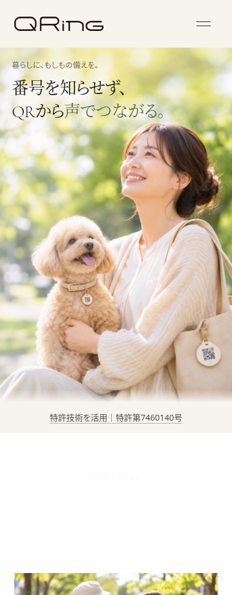 | 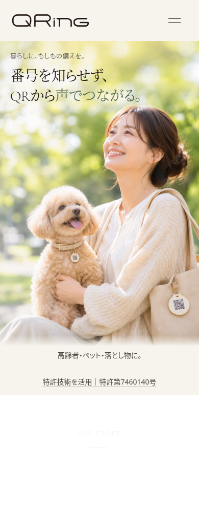 |

### HOME HERO・1280px

| 変更前 | 変更後 |
| --- | --- |
|  | 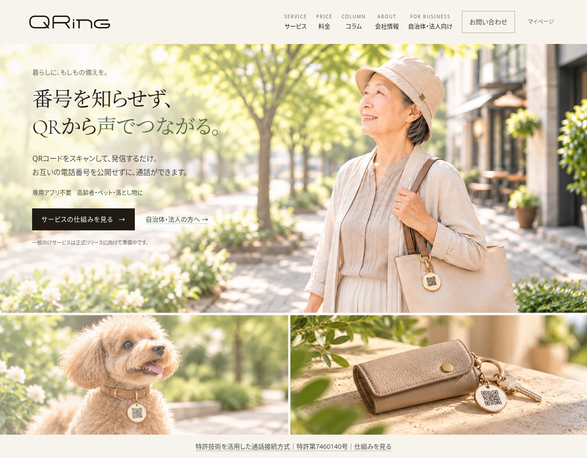 |

### HOME料金末尾・390px

| 変更前 | 変更後 |
| --- | --- |
| 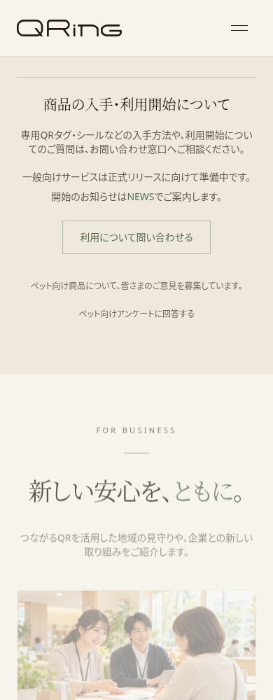 | 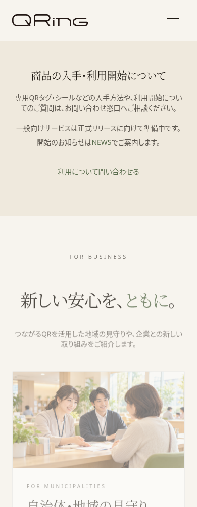 |

### ペットH1・390px

| 変更前 | 変更後 |
| --- | --- |
| 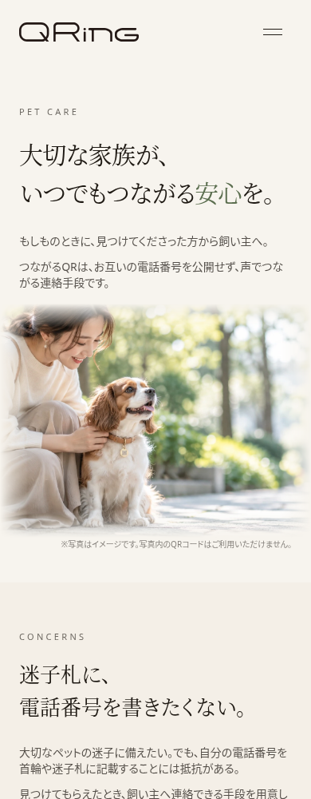 | 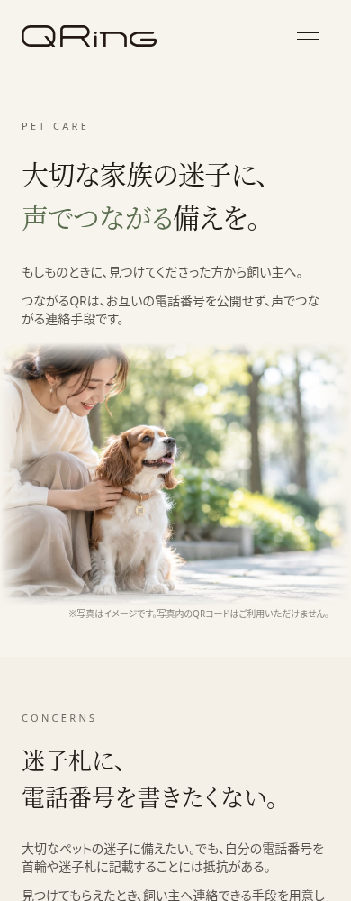 |

### FAQ・390px（対象2問を展開）

| 変更前 | 変更後 |
| --- | --- |
| 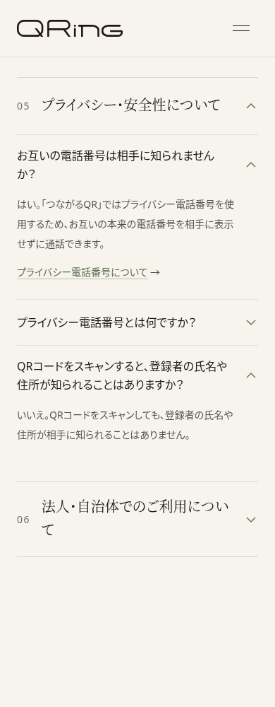 | 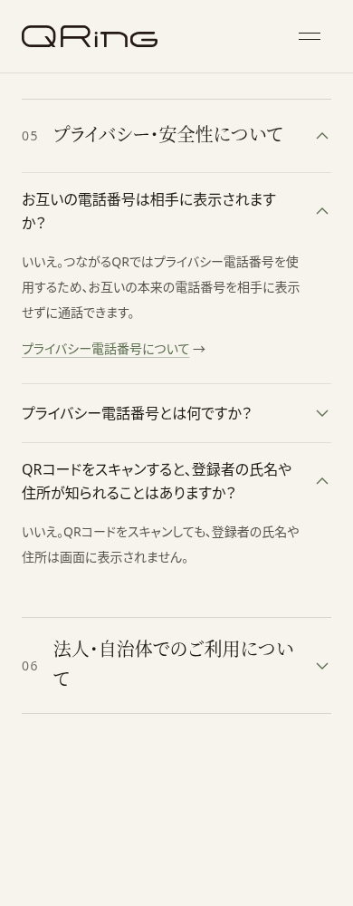 |

### 自治体・390px

| 変更前 | 変更後 |
| --- | --- |
| 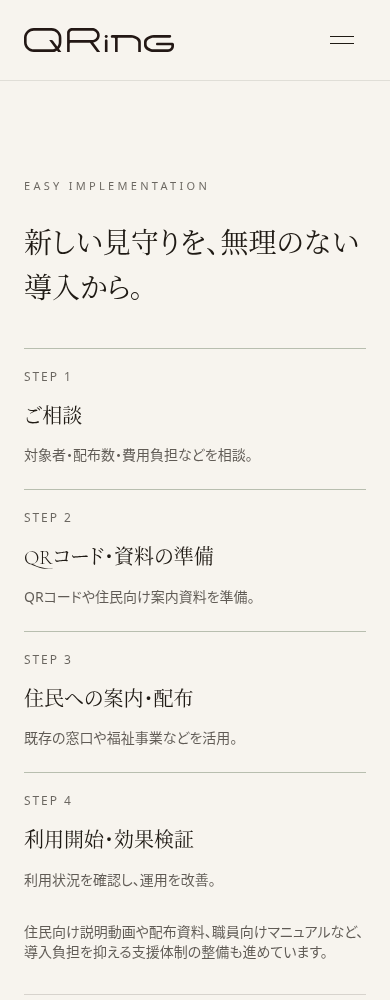 | 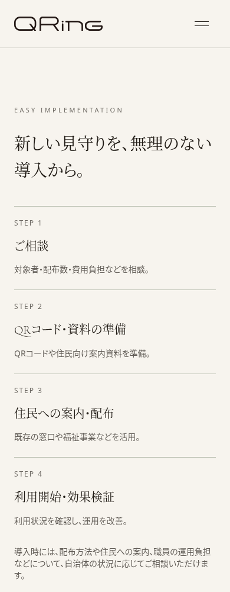 |

### 料金CASE 01・390px

| 変更前 | 変更後 |
| --- | --- |
| 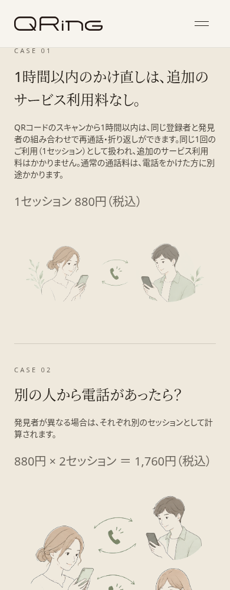 | 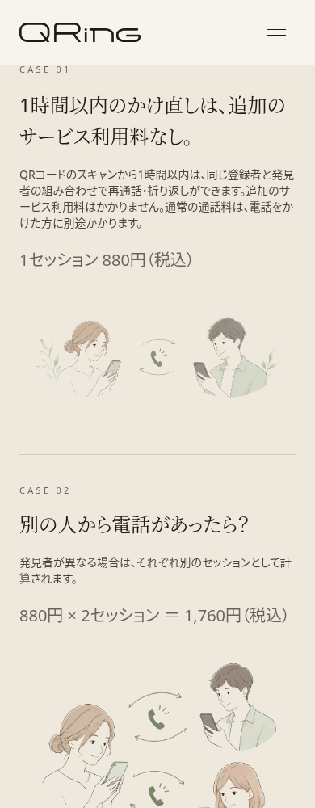 |

## 検証結果

- production build成功。`test:columns`、`test:scheduled-columns`、publication 10件、`test-hero-copy-review.cjs`成功。
- `check:column-export`（日付整合性含む）・`check:column-navigation`成功。公開25記事・一般一覧3ページ・関連記事/内部リンクの検査を維持。
- SEO監査：44ページ、エラー・内部リンク切れ0。変更した5ページのtitle・meta description・canonical・JSON-LDが変更前と一致。
- HOMEは320/375/390/430/768/1280pxを比較。横スクロールなし。写真とH1の位置・寸法・画像パス・fit・positionが同一。用途説明はモバイルだけ表示され、HOMEコラムの日付非表示とアンケート削除を確認。測定値は [browser-checks.json](browser-checks.json)。
- 390pxでペットH1・アンケートの存在、FAQのカテゴリ開閉と対象2問の回答表示、自治体・料金の表示を確認。外部リクエストはブラウザ検証時に遮断し、GA4へテストクリックを送信していない。
- 利用規約・プライバシーポリシー・PetSurveyLink（フォームURL/計測）・HeroVisual/CSS・SOLUTION・HOW IT WORKS・HOMEピックアップ・記事データはmainとバイト一致。画像・料金値・公開処理も変更していない。
- HOMEへのFAQ・「認知症」の文言追加なし。SOLUTIONとHOW IT WORKSとPC HEROの「専用アプリ不要」は維持。通知フォーム・OGP画像設定は対象外。

変更ファイルは6つの表示用TSX/TSファイル（HOME・FAQ・ペット・自治体・料金・HOME料金部品）、旧プレビュー生成スクリプトとそのテスト、今回の資料・スクリーンショット。Draft PRとして提出し、マージ・本番公開は行わない。
