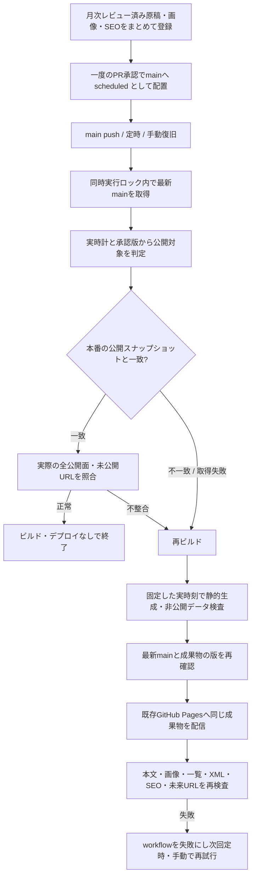

# コラム自動公開：原因調査・修復

調査日：2026年11月28日（日本時間）。基点：PR #184マージ後の `387b82733e510b2bf990f9e2987fbaec1e12929d`。本件は専用ブランチのDraft PRであり、main・本番設定を変更せず、デプロイも起動しない。

- [月次登録・変更・障害対応の運用手順](operations.md)
- [テスト結果・検証範囲](verification.md)
- [取得した実行履歴・ログ抜粋](evidence.json)
- [実ビルド＋HTTPの公開境界検証結果](static-boundary-results.json)

## 1. 当初の構成と実際の原因

Next.jsの `output: export` による静的サイト。コラムの元データは `src/content/columns/published.json`。名前に反して、将来の日時の記事も格納できるレジストリとして使われてきた。本文は構造化ブロック、SEO・画像・出典・関連記事・版と承認を同じArticleレコードで管理する。

当初は、承認済み記事を `published` にして将来の `publishedTimestamp` を持たせ、日付の到来後に定時再ビルドして公開する構成だった。`status: scheduled` は型には存在したが、公開セレクターでは対象外だった。後半の原稿は `draft / publicationPending=true / approvalRevision=null` として未マージPRへ置かれ、当日ごとの公開指示でmainへ移し、フラグを変更する運用へ変わっていた。

**主原因は、月次の「レビュー済み予約記事」を登録・判定する経路と、実際の原稿配置・承認状態が一致していないこと。** 定時処理が成功しても、mainにない原稿や未承認の下書きは公開されない。調査時点のmainは公開済み28記事のみで、予約記事は0件。29・30日の改訂原稿は別ファイルの未承認下書きであり、#134も未マージ。これらを予約済みと扱うことはできない。

### コードと履歴

| 証拠 | 確認内容 |
|---|---|
| `src/lib/columns/publication.ts`（修正前） | `status !== "published"` を除外。承認待ちプレビューだけ例外。`scheduled` も時刻に関係なく除外 |
| `scripts/column_export_support.py`（修正前） | Python側も `status == 'published'` を要求。日時判定をTSと別実装 |
| `src/lib/columns/index.ts` | ページ群は同じ公開セレクターを使用。元データをクライアントへ直接渡さずカードへ限定投影 |
| `src/app/column/[slug]/page.tsx` | `force-static`、`dynamicParams=false`。ビルド時の対象だけ個別ルートを生成。時刻到来だけでは更新しない |
| `src/app/sitemap.ts` | 同じ公開対象からXMLを生成。未公開記事をURLに追加しない。既存のlastModified省略方針は本件でも変更しない |
| `483e06d` | 静的出力とGitHub Pages配信を導入 |
| `6ebd320` | 08:00 JSTの予約公開向け定時再ビルドを追加 |
| `d02c0df` | 11/8〜15の承認済み原稿・日時境界検査を登録 |
| `d3117c2` | 07:50の準備と08:15／08:45再試行、実時計・本番照合を導入 |
| `ad0670c` | HOMEが固定ピックアップになった後のライブ照合を修正 |
| `docs/publications/2026-11-24.md`〜`28.md` | 当日の原稿を手動でmainへ追加し、`published`・承認版・pendingを切り替えた記録 |
| PR #134 | 11月後半の原稿を含む古い未マージバッチ。mainへの登録済みとは異なる |
| PR #184の原稿受領記録 | 29・30日は未公開のまま維持する指示を反映。今回も自動承認・前倒し公開しない |

### 副次的な原因・確認できた障害

| 実行・ログ | 実際の障害・現状 |
|---|---|
| [11/24 run 45344102978](https://github.com/akizu815-create/QRing/actions/runs/45344102978) / job 138274703457 | Pages転送は成功。その後の `Latest due article missing from HOME` で3回失敗。固定ピックアップを最新順と誤認した検査が原因。既存修正済みであり元へ戻さない |
| [11/25 run 45553322635](https://github.com/akizu815-create/QRing/actions/runs/45553322635) / job 138999374267 | `AssertionError: care-levels: registration differs` によりビルド前に停止。deployはskip、publication-statusが連鎖失敗。採用済みSEOと旧登録器の不整合。現mainでは修正済み |
| [11/28 run 46108814002](https://github.com/akizu815-create/QRing/actions/runs/46108814002) | schedule実行でbuild・Pages配信・本番照合すべて成功。公開28件・最新28日記事を確認。定時workflowが全面的に無効・権限不足という証拠はない |
| 同run job 140867514182 | `COLUMN_SCHEDULE: 15,45 23 * * *` に対し、実際のcutoffは `2026-11-28T04:43:15+00:00`＝13:43:15 JST。UTC23:15／23:45＝JST08:15／08:45というcron自体の変換は正しい。実行遅延が観測されたが、そのGitHub内部の理由は未確認 |
| 修正前のcron | 朝3回だけで、その後は翌日まで再確認しない。朝の失敗や遅延を当日中に継続回復する仕組みが不足 |
| 修正前のライブ照合 | 全記事の一覧・XMLは見るが、本文の照合は最新1件だけ。未来URLへの直接アクセス、全記事の画像・noindex・OGPなどを確認していなかった |
| PR #184の固定スナップショット検査 | 将来29・30日を正当に承認・登録しても、公開データと過去の下書きのID重複を無条件に禁止していた。現時点の障害ログではなく、今回コードとテストで確認した潜在的な公開阻害要因。履歴を保護しつつ正当な公開への遷移を検査する形へ修正 |

## 2. 調査した想定原因の判定

- scheduleはmainのworkflowに存在し、最近も実行されている。デフォルトブランチはGitHub APIでmainと確認。現在のworkflow無効化設定の管理画面値は未取得だが、11/28のschedule成功を確認。
- cronのUTC→JST変換や、日付のみを00:00 JSTとして扱う既存処理が主原因とは確認できなかった。新しい予約登録では `+09:00` の日時を必須とし、TS・Python・運用ツールの判定を一本化。
- 一覧・詳細・XMLの公開判定がばらばらという不具合は確認しなかった。既存の共通入口を維持して予約対象を追加。
- ビルド時刻に固定される静的サイトであることは確認。常時動的なサイトへは移行しない。
- GitHub Pagesはログ上、OIDC・Pages権限による配信が成功し、環境URLは `https://www.qring.jp/`。`public/CNAME` も同じ。Cloudflare Pagesは確認できた範囲でブランチプレビュー。不要と判断してPagesを停止・移行する根拠はない。
- Pages Source、環境の保護ルール、現在のDNS・CDNキャッシュ設定、Cloudflare管理画面・hook・秘密情報の現値は接続ツールでは取得不可。確認済みと扱わない。
- 本番HTTPの新しい直接照会は作業環境のプロキシで拒否された（CONNECT 403、originの応答は未取得）。本番サイトが403を返すという意味ではない。実行ログの本番照合成功と区別する。

## 3. 修正後の処理フロー

修正前は「main上のpublished記事を朝3回ビルド」。修正後は「月次の承認済みscheduled記事を実時計で公開対象にし、終日収束させる」。記事の状態を毎日書き換える処理や日次コミットはない。

## 4. 修正したコード・設定

| ファイル・領域 | 変更内容 |
|---|---|
| `src/lib/columns/releasePolicy.js` / `.d.ts` | 明示的な時差・暦日を検証し、公開済み／予約済み・pending・承認版・品質結果を一元判定。現時刻は呼出側から受け取る純粋処理 |
| `src/lib/columns/publication.ts` / `index.ts` | 既存のArticle検証を残し、共通ポリシーを利用。未承認下書きは対象にしない |
| `scripts/column-release-indices.cjs` / `column_export_support.py` | Python検査も同じJSの判定結果を使用。別言語の日付条件を並行保守しない |
| `scripts/build-site.cjs` | 一度取得した実時刻をNext.jsへ渡す。実時刻がビルド中に次の予約を越えた場合は最大1回再ビルドし、未来時刻への前倒しはしない |
| `scripts/column-publication-state.cjs` | 公開済みのslug・版・内容／画像ハッシュ・元commitだけをスナップショットに出力。未公開の本文・予定一覧を出さない。公開出力中の未来データを検出し、記事専用の未公開画像コピーも除外 |
| `scripts/plan-column-publication.py` | 元commit・公開対象内容と本番スナップショットを比較。一致時も実際の公開面を検証してからno-op。不一致なら再ビルド |
| `.github/workflows/deploy.yml` | main限定と既存Pages権限・ロックを維持。計画→必要時だけbuild→配信→検証。配信直前に新しいmainへ変わっていたら古い成果物を配信せず失敗・再試行 |
| `scripts/check-live-columns.py` | 全対象記事のH1・本文全ブロック・画像応答・SEO title・description・canonical・OGP・Article JSON-LD・noindex、一覧／ページ送り／関連記事／XMLを照合。未来・保留URLは直接404/410を要求。HTTP200のエラーページも失敗 |
| `scripts/column-month.cjs` / `check-column-schedule.cjs` | 月次packet検査・ローカル登録。12月31日すべてを準備できること、版・承認・日時・画像・受領ハッシュを確認。予約全件を到来前からCI検査 |
| watchdog workflow / script | 別トリガーで公開workflowの最終成功を監視。120分以上正常収束がなければ失敗通知の対象にする |
| 既存原稿照合・export検査 | 歴史的な未承認原稿の保護と、その後に承認された公開版の検査を両立 |
| tests / package.json / CI | 日時・復旧・キャッシュ・二重実行・月次packet、隔離環境の実静的ビルド＋HTTP検査を追加 |

コラム本文、画像の原本、公開日・時刻、SEO文言、サイトデザイン、料金・法務文書を変更していない。

## 5. 実行時刻・復旧・通知

- 通常の再確認：UTC毎時13・43分＝JST毎時13・43分。1日48回。既存の07:50 JST準備を別に1回維持し、08:00まで実時計で待機。計49回の起動予定だが、反映済みならnpm ci・ビルド・配信は省略。
- 予約の起点は各記事の `publishedTimestamp`。8時以外にも設定可能。日付のみの既存データは00:00 JSTとして従来どおり扱い、新規月次packetは時差付き日時を必須にする。
- 失敗後は次の起動で「今までの全対象」と本番を比較するため、前日分も回復対象。特定の当日1件だけを探す方式にしない。
- 本文検証は最大3回、待機10秒・20秒で再試行。失敗を成功に置き換えない。デプロイ失敗・ビルド失敗は次回の不一致として再検出。
- 手動復旧はActionsの `workflow_dispatch`。任意の未来時刻入力は設けない。`force_rebuild=true` で同じ内容でも再配信可能。
- 正常なno-opでIssueや独自メールは送らない。失敗は既存のGitHub Actionsの失敗通知を使用。メール配送設定はアカウントごとの設定であり、未確認・変更していない。
- watchdogはUTC毎時29分（JST同分）に別workflowとして起動。公開処理の停止・失敗・長時間の未起動を検出する。ただしGitHub Actions全体や両workflowが停止・無効化されたときは同じ基盤内で通知できない。完全な独立監視には別基盤の外形監視が必要であり、追加契約・設定は行わない。

**GitHubのscheduleは遅延・欠落し得るため、予定時刻ぴったりの公開は保証しない。** 30分間隔は実行機会の予定であり、最大30分での復旧保証でもない。厳密な時刻保証が必要なら、ホスティングや独立スケジューラの別途検討・承認が必要。今回は既存構成での運用負担と変更範囲を優先した。

## 6. 本番反映前の作業と未確認事項

1. 本Draft PRのCI・プレビュー・運用手順を確認し、代表者がマージを承認する。
2. 現在のPages Source・github-pages環境保護・Actionsのschedule許可・GitHub通知を管理画面で確認する。現行配信に成功している既存権限を使い、新しいトークン・Cloudflare hookは不要。
3. 承認直前に古いworkflow版の実行・待機が残っていないことを確認し、残っていれば担当者が整理する。承認後mainへマージすると既存のpush経路が新workflowを実行する。初回は本番に新スナップショットがないので再ビルド・配信し、全公開面と保留URLを検査する。
4. 次の定時実行がno-op、次の予約境界がbuild→配信→検証になることを本番ログで確認する。本件では未実施。
5. 本番の未公開URL・画像が404/410であること、本文・OGP・XML・スナップショットが同じ版であることを確認する。
6. 12月原稿・イラストは別制作後、月次packetとして一度レビュー・登録する。本件に実際の31記事は追加していない。

追加の外部サービス契約・秘密情報の登録・本番環境設定変更は実施していない。標準のActions実行回数は増えるため、アカウントの利用枠・課金状況は確認対象。追加の常時サーバー・DB・配信サービスは不要。

**29・30日分は依然として未承認で、公開予約として登録されていない。今回のシステム修復だけでは公開されない。** レビュー・公開承認を得て予約記事として登録する必要がある。未承認原稿を公開して見かけ上の自動公開成功にする対応は行わない。
